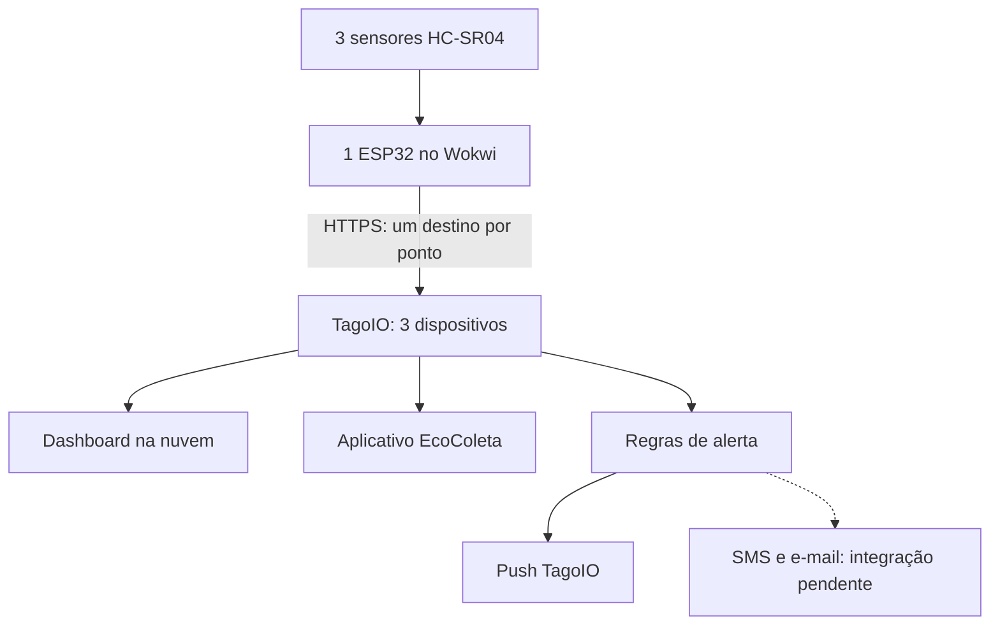

# EcoColeta

Protótipo acadêmico de Internet das Coisas para acompanhar o preenchimento estimado de lixeiras em vários pontos e ajudar a priorizar a coleta.

**Faculdade Nova Roma · Projeto da Unidade 2 · João Gabriel Barbosa Costa**

## O projeto

Um ESP32 simulado no Wokwi lê três sensores ultrassônicos HC-SR04. Cada sensor representa uma lixeira: **Entrada principal**, **Pátio** e **Cantina**. Os dados seguem por Wi-Fi e HTTPS para três dispositivos separados na TagoIO. Um aplicativo feito no MIT App Inventor consulta a nuvem e apresenta os níveis, a prioridade de coleta, o histórico e relatórios.

O percentual é uma estimativa pela altura dos resíduos. Não representa medição de peso nem medição direta de volume.



## Situação da entrega — 25/11/2026

| Parte | Situação |
| --- | --- |
| Simulação de três pontos no mesmo ESP32 | Montagem e código disponíveis; versão anterior compilada e exercitada no Wokwi |
| Comunicação com a nuvem | Recepção de dados dos três dispositivos confirmada |
| Dashboard TagoIO | Criado, com três medidores independentes |
| App | Código-fonte, demonstração web e projeto `.aia` disponíveis |
| Limite crítico | 90% ou mais nesta versão do app e do firmware |
| Push | Uma notificação foi gerada na TagoIO durante teste; recebimento no iPhone ainda não confirmado |
| Repetição dos avisos na nuvem | Ajuste pendente: o painel não preservou a condição de desbloqueio; as três regras ficaram **pausadas** |
| SMS e e-mail | Dependem da configuração de provedores e de teste de entrega; **não concluídos** |

O repositório não instala nem configura automaticamente uma conta TagoIO. As instruções de nuvem e os modelos de regras não equivalem a uma implantação validada. Veja [estado e limitações](docs/ESTADO_E_LIMITACOES.md).

## Abrir a demonstração sem contas

Baixe o repositório em **Code → Download ZIP**, extraia e abra [EcoColeta_demonstracao.html](aplicativo/EcoColeta_demonstracao.html) no navegador. Ela inicia em demonstração local. Os dados desse modo são simulados, e os avisos aparecem enquanto a página está aberta.

Para servir o código-fonte localmente:

```bash
python3 -m http.server 8000 --directory aplicativo/web
```

Abra `http://localhost:8000`. Essa execução não publica o app na internet.

## Executar no Wokwi

1. Crie um projeto ESP32 no [Wokwi](https://wokwi.com/projects/new/esp32).
2. Substitua `sketch.ino` e `diagram.json` pelos arquivos da pasta [wokwi](wokwi/).
3. Inicie a simulação e abra o monitor serial em 115200 baud.
4. Para enviar à nuvem, informe **um comando por vez**, usando tokens de dispositivos de teste da sua própria conta:

```text
TOKEN_01=SEU_DEVICE_TOKEN_ENTRADA
TOKEN_02=SEU_DEVICE_TOKEN_PATIO
TOKEN_03=SEU_DEVICE_TOKEN_CANTINA
```

Os exemplos acima são marcadores: substitua por UUIDs válidos, sem aspas. Entrada corresponde a `LIXEIRA_01`, Pátio a `LIXEIRA_02` e Cantina a `LIXEIRA_03`. Não use o mesmo token em dois pontos. Não grave tokens em um projeto público.

O comando `DESCONECTAR` limpa os tokens da sessão. Reiniciar a simulação também exige informá-los novamente.

| Distância simulada | Preenchimento aproximado | Situação |
| --- | --- | --- |
| 40 cm | 0% | Normal |
| 12 cm | 80% | Atenção |
| 8 cm | 91% | Crítico |
| 5 cm | 100% | Crítico |

Cada sensor pode ser alterado separadamente clicando nele no simulador. A leitura simulada pode variar ligeiramente em torno da distância selecionada.

| Ponto | TRIG | ECHO | LED |
| --- | --- | --- | --- |
| Entrada principal | GPIO 5 | GPIO 18 | GPIO 23 |
| Pátio | GPIO 19 | GPIO 21 | GPIO 22 |
| Cantina | GPIO 26 | GPIO 27 | GPIO 25 |

O diagrama inclui resistores de 220 Ω nos LEDs e divisores de 1 kΩ/2 kΩ nos sinais ECHO. Para montagem física, revise a alimentação e a proteção dos GPIOs de 3,3 V.

## Usar no celular

1. No [MIT App Inventor](https://ai2.appinventor.mit.edu/), importe [EcoColeta.aia](aplicativo/EcoColeta.aia) em **Projects → Import project (.aia) from my computer**.
2. Instale o MIT AI2 Companion no celular.
3. No computador, use **Connect → AI Companion** e leia o QR Code pelo Companion.
4. Em Ajustes, selecione cada ponto, a origem Nuvem e a região da sua conta, e informe o respectivo Device-Token.

O projeto tem uma ponte nativa Web para consultas no Companion do iPhone. O `.aia` é o projeto editável, não um aplicativo publicado na App Store. Avisos internos do EcoColeta não são push de sistema em segundo plano. Para esse canal, é necessário configurar a TagoIO e validar o aplicativo oficial com a conta correspondente.

## Regras de negócio

- Normal: abaixo de 80%.
- Atenção: de 80% a menos de 90%.
- Crítico: 90% ou mais.
- Aviso crítico interno: novo aviso após queda abaixo de 85% e novo cruzamento de 90%.
- Coleta provável: nível observado de pelo menos 50%, seguido de três leituras válidas de até 20%.
- Leitura com mais de dois minutos: sinalizada como antiga.

Coleta provável é uma inferência por mudança de nível; não comprova uma coleta realizada por uma pessoa.

## Conteúdo

| Pasta | Conteúdo |
| --- | --- |
| `wokwi/` | Firmware de três sensores e circuito |
| `aplicativo/` | Projeto importável, demonstração e fontes HTML/CSS/JS |
| `nuvem/` | Orientação para dispositivos, painel e alertas |
| `testes/` | Testes de lógica, transporte e estrutura do App Inventor |
| `ferramentas/` | Geração reproduzível do `.aia` e da demonstração |
| `docs/` | Limitações, verificação e roteiro de apresentação |

## Verificar e recriar os arquivos

Pré-requisitos: Node.js para os testes JavaScript e Python 3 para as ferramentas e os testes de `.aia`.

```bash
python3 ferramentas/gerar_aia.py
python3 ferramentas/gerar_demo.py
node testes/core_test.js
node testes/transport_test.js
python3 testes/aia_test.py
python3 testes/aia_bridge_test.py
```

Esses testes não comprovam envio de SMS, e-mail ou push no iPhone, nem substituem a compilação e a execução do firmware no simulador.

## Segurança e condições de uso

Os tokens entram em tempo de execução e não acompanham este repositório. O firmware virtual usa `setInsecure()` exclusivamente no laboratório, portanto não valida o certificado do servidor. Uma implantação física exige validação TLS por CA, proteção das credenciais e revisão do consumo de dados. O intervalo de envio é curto para demonstração; evite deixá-lo ativo continuamente sem conferir as cotas da conta.

Para a apresentação, veja o [roteiro com falas e demonstração](docs/APRESENTACAO.md).
